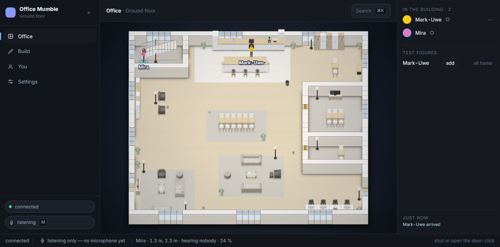
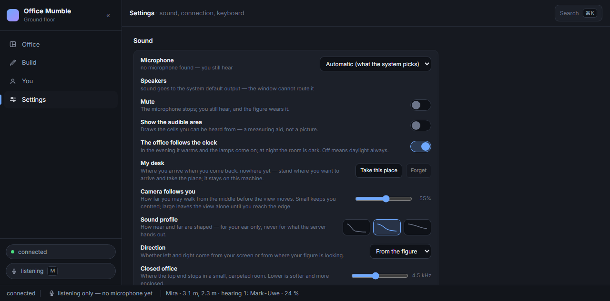
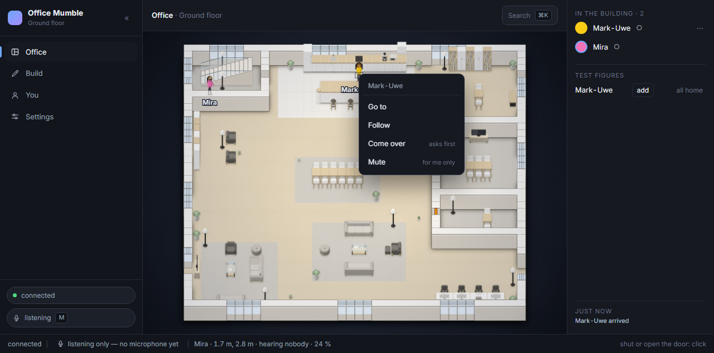
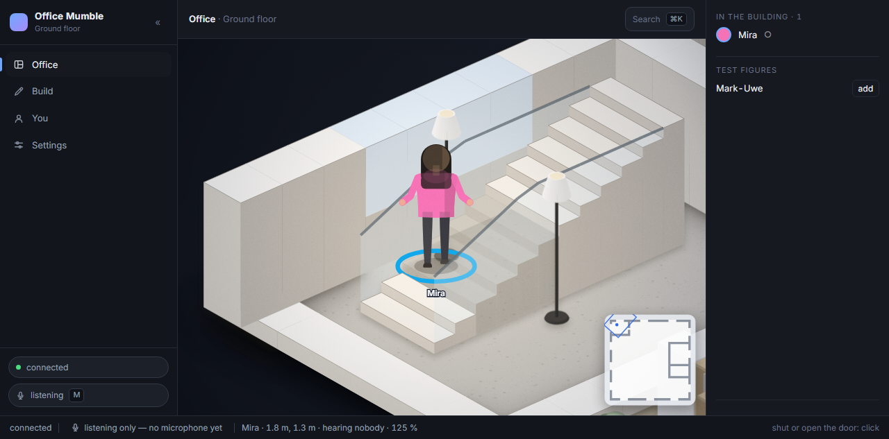
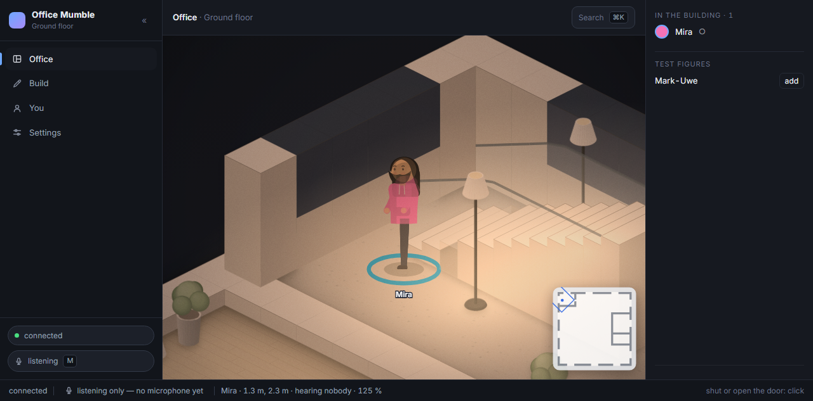
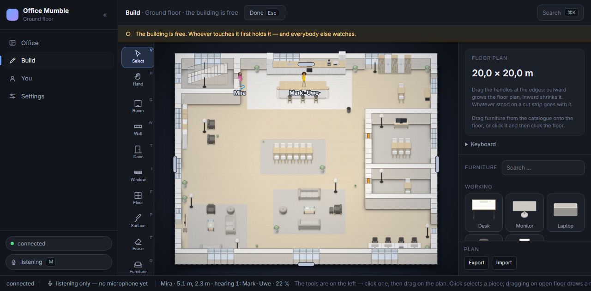

# Office Mumble

**A self-hosted office you can walk through — and hear.**



Your team on one floor plan in the browser. Click where you want to go and your figure walks there; voices
come from where people actually stand. No meeting, no link, no account, no cloud — one server on your own
network.

## Sound

- **Every voice sits where its owner stands.** One connection per person in earshot, none for anybody else.
- **Walls and shut doors cut the stream.** Not turned down — cut. The people behind them go silent at once and
  come back when the door opens.
- **Distance fades.** Two thresholds with a fade between them, and past the second no stream at all. Around a
  corner it is the way round that counts, not the straight line.
- **A room sounds like its size.** Carpets and soft furniture take the top off a small office; a tall open
  floor keeps it. A short tail, never a church — four sliders in the settings, from studio to hall.
- **The stair is the one place the ceiling is not a wall.** Going up, the voices below fade out and the ones
  above fade in, tread by tread.
- **The pan follows where your figure looks.**
- **Three profiles, two perspectives.** *near*, *room*, *wide*; heard from *your figure* or *your screen*.
- **A door is a wall you can work.** Click one within a metre and a half; the handle turns when you arrive.
- **Go to, follow, come over, mute.** Right-click a figure — or their row — to walk to them, walk after them
  until you go somewhere yourself, ask them to join you, or turn them down for your ear only.
- **A call is an invitation.** *Come over* shows them who is asking and lets them answer Go or Not now; after a
  minute it is gone.
- **The ceiling is a wall.** Nobody upstairs is in the room — except on the stair. The sidebar says who is up
  there.





## Look

- **Two floors, one stair.** You walk the treads; the floor changes at the top step, not the first. The flight
  stands up as treads you can count, comes down into a well upstairs, and is stepped onto at its foot only.
- **From behind your figure.** `V` brings the camera down behind you, along one of four diagonals, and turns it
  only when you turn back towards it; `0` shows the whole floor again.
- **Windows are cells of their own.** They let the day in and stop you walking through.
- **The day runs on the clock.** Dusk from 15:00, lamps from about 18:00, fully lit at 21:00.
- **Lamps light what stands next to them.** A floor lamp its corner, a table lamp its table; the corridor
  between them stays dark.
- **Furniture is furniture.** Desks, tables and shelves block the way; chairs do not.
- **Two editors.** *Build*: walls, doors, windows, floors, furniture, floor by floor — every gesture previewed,
  checked by the server and broadcast to everybody, with a lock for whoever is building. *You*: a figure of
  parts and colours, seen by nobody until you hand it over.
- **The plan is a file.** Out and back in; it lives on the server and survives a restart.
- **The same desk every time.** Stand where you want to arrive, take the place, come back to it after a reload
  or a week away. Until you have taken one, you arrive in the kitchen, by the coffee machine.
- **One list, and it stays put.** Everybody in the building, alphabetical, with a mark for what they are to
  you: filled dot means heard, open dot means on your floor, an arrow means a floor up or down. What just
  happened — who came, who left, who changed floor — sits at the foot.
- **Figures speak with their mouth.** Up close it opens and closes; further out a ring at the feet says it.







## What it is not

No chat, no calendar, no integrations, no dashboard, no account, no cloud.

## Run it

Needs **Node 22+** and **Rust**. pnpm is not needed: corepack hands out the version `client/package.json`
names. On Windows, Rust wants the C++ build tools (`winget install Microsoft.VisualStudio.2022.BuildTools
--override "--add Microsoft.VisualStudio.Workload.VCTools --includeRecommended --passive"`).

```sh
node harness/run.mjs all
```

That builds the client if needed, runs the floor, and opens the browser where it is. The first visit asks you
to accept the server's own certificate — one click per machine. Then click once in the page: a browser hands
out neither microphone nor sound without a gesture. Headphones, because an open microphone next to a
loudspeaker is a loop.

The desktop app makes presence true: lock the screen and you leave; unlock it and you are back under the same
name and figure.

Colleagues on other machines, the certificate, the firewall, the desktop app, and the Opus build for speaking
test figures: **[setup](docs/setup.md)**.

## Tests

```sh
cargo test                          # model, edits, the server's decisions, the hearing rule
cd client && pnpm test              # the client's pure parts
cd client/src-tauri && cargo test   # the app: presence, the address it is built for
```

Both halves answer the same `fixtures/hearing-cases.json`, so the rule in Rust and the rule in TypeScript stay
one rule.
