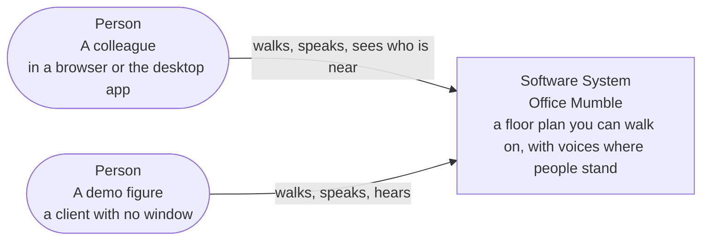
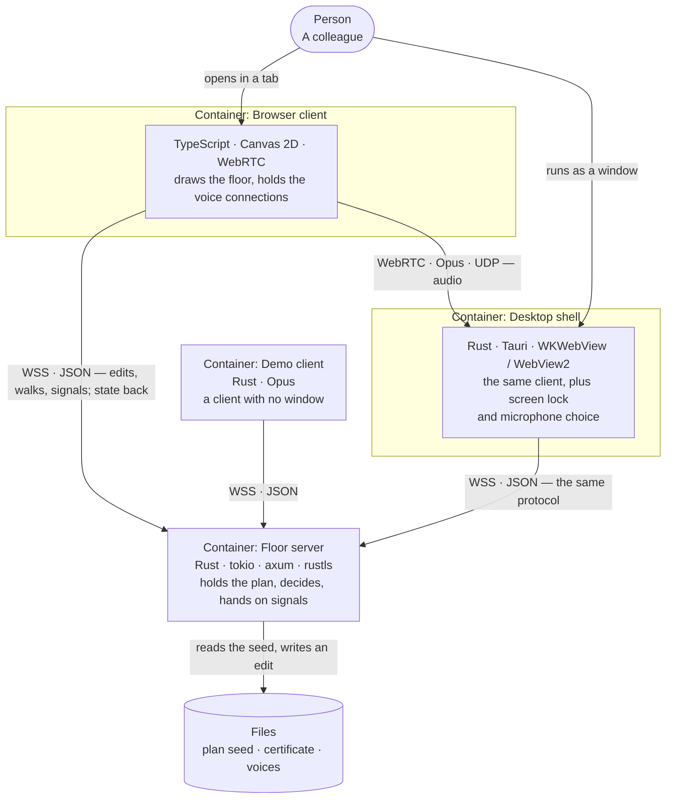
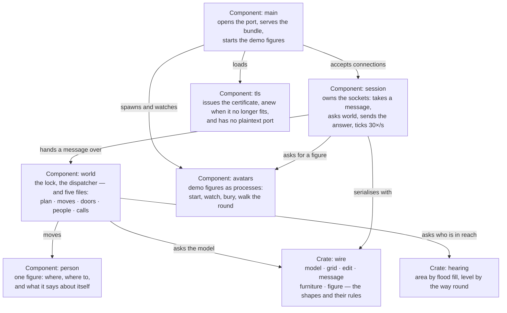
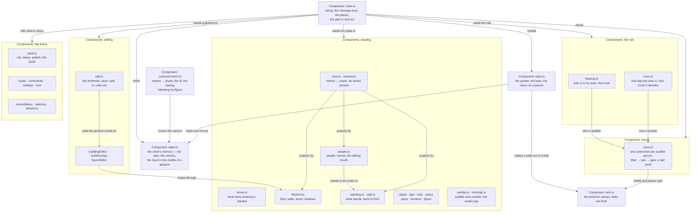
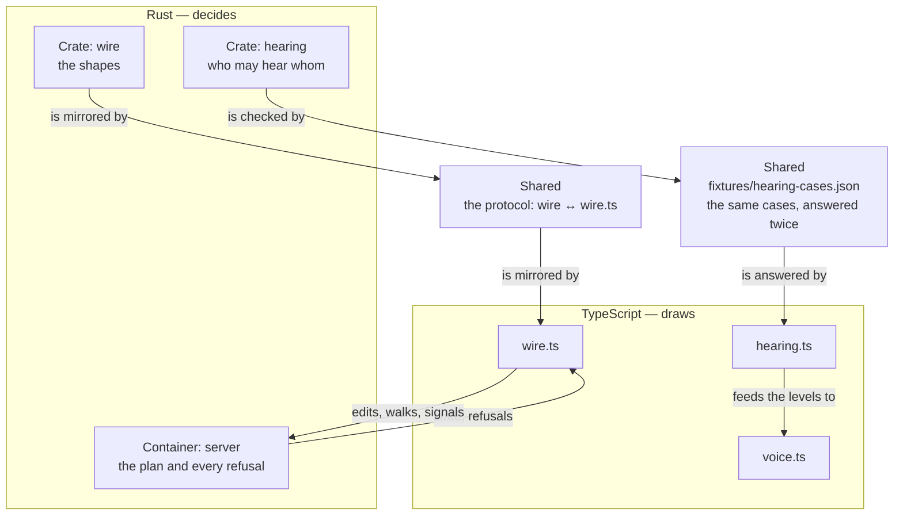
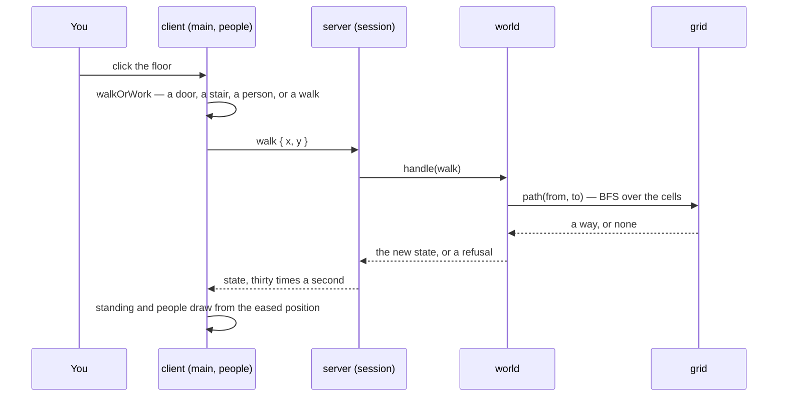
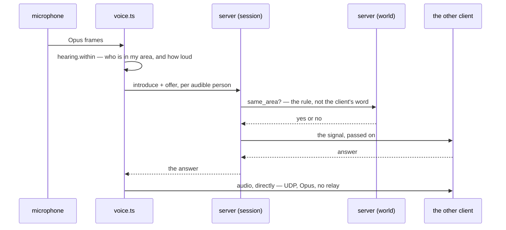

# Architecture

This page is written in the terms of the [C4 model](https://c4model.com/). Level 1 is the system and the
people around it. Level 2 is the **containers** — the separately running things the system is made of, and
the relationships between them, including the ones between two clients. Level 3 takes one container at a
time and shows its **components**: modules with one responsibility behind a clear interface. Level 4 — code
— is skipped on purpose; it would say what the code says already.

Two walks through the building follow the layers: what happens when you click the floor, and what happens
when you speak.

The whole design rests on one sentence: **the server holds the plan and decides about it; the client holds a
copy and draws it.** Everything below is a consequence of where that line runs.

## How it runs, in one page

Before the layers: where the pieces actually sit, and what runs when.

**Two kinds of process, and nothing else.** One Rust process is the floor: it holds the plan and the list of
people in its own memory, listens on one TLS port, and runs one loop that wakes thirty times a second. Every
browser tab is a process of its own: it holds the last state it was sent, draws it on a canvas, keeps one
WebSocket to the floor and one `RTCPeerConnection` for each person it can hear. The desktop app is that same
tab in a window. A demo figure is a small Rust process the server starts itself — a client with no window.

**Nothing is shared but messages.** No client reads another client's memory, and the server never holds an
audio stream. The only things that cross the wire are the messages in `crates/wire/src/message.rs`.

| When | You send | What the server does |
|---|---|---|
| a tab opens | `join` | makes a person, answers `hello`, `plan`, `state` |
| thirty times a second | — | moves people along their paths, takes the stair, sends `state` to everybody |
| you click the floor | `walk` | BFS over walkable cells; `state`, or `no way` if there is none |
| you click a door | `toggleDoor` | checks the 1.5 m reach itself; `state` to everybody |
| you edit the plan | `edit` | validates against the model; `state` to all, or `refused` to you alone |
| you start speaking | `introduce`, then `signal` (offer) | checks `same_area`, passes it to that one client |
| the other side answers | `signal` (answer) | passes it back |
| your voice crosses the threshold | `speaking` | marks you, so the mouth and the ring move on every screen |
| you mute | `muted` | marks you; the sound stops on the sending side |
| you ask somebody over | `summon` | shows them `summoned`; their answer returns as `summonAnswer` |

**One click, in order.** The tab turns the click into a point on the plan and sends `walk`. The server finds
a way with BFS over walkable cells — furniture is a wall, a shut door is a wall, a chair is not — and stores
it on the person. From then on the tick moves that person a little along the path, thirty times a second,
and every client draws the position it was last told. The client never moves anybody; it only eases towards
where the server said they are.

**One door.** A click on a door is a `walk` first when you are far away: the tab walks you there, and when
your feet are within a metre and a half it sends `toggleDoor`. The server checks that distance itself and,
if it holds, flips the cell and sends the whole plan's state to everybody — which is why a door cuts every
voice at once, and not only yours.

**One word.** Your tab decides whom you can hear (the rule, locally), and for each of them opens an
`RTCPeerConnection` and sends an offer through the server. The server does not listen in: it checks that the
two of you are in one area and passes the signal on. The answer comes back the same way. From then on the
audio is between the two tabs — UDP, Opus, no relay. The server is out of it.

### Who computes what

The line between Rust and TypeScript is not "the server does the hard things". It is: the server answers
questions that must have one answer for everybody, and the client answers questions about its own ear.

| Question | Answered in | Why there |
|---|---|---|
| May these two hear each other at all? | Rust (`hearing`) **and** TypeScript (`hearing.ts`), from one set of cases | the server is the authority; the client needs the answer thirty times a second without a round trip |
| How loud, and how far — round which corner? | TypeScript (`hearing.ts`) | it is a flood fill from where the listener stands |
| How does the room sound: how big, how much it absorbs, how long the tail? | TypeScript (`room.ts`) | it depends on the ear — which room I am in, and what is in it |
| Which side, which filter, how much of the hall? | TypeScript (`voice.ts`) | the same ear, and it changes as I turn |
| Where is everybody, and may I walk there? | Rust (`world`) | one truth for every client |
| May this door open, may this edit land, does it leave anybody in a wall? | Rust (`world`) | one truth for every client |

So the acoustics are entirely in TypeScript, and that is on purpose. A room is not a property of the server:
it is a property of the person standing in it. The server would have to compute one room per listener, per
tick, and send it — the client already has the plan, the walls and everybody's place, and it has to run the
rule for its own speakers anyway.

**What it costs.** Measured on the machine that runs this office (a Raspberry Pi, Node 22, the 40×40 ground
floor, `client/bench-rule.ts`): one flood fill 0.36 ms, the room and its absorption on top of it 0.52 ms,
ten people heard 0.37 ms — together about **1 % of the 33 ms tick**. Rewriting that in Rust would buy a tenth
of a millisecond and cost a second language in the hot path.

The expensive parts of audio are not this arithmetic, and none of them are JavaScript: an Opus frame is
20 ms, the jitter buffer another 20 to 100 ms, the network its own. The encoder, the decoder, the filters
and the panners are native code inside the browser — `voice.ts` only sets their parameters.

So Rust is in the audio path exactly where there is no browser: `crates/voice` is the demo client's own
Opus encoder, because a headless figure has no WebRTC to borrow. Were we to write DSP the browser does not
have — a different reverb, a beamformer — the seam is still `voice.ts`: an `AudioWorklet` behind it, running
Rust compiled to WebAssembly, would change one node and no architecture. What would change the architecture
is putting audio *through* the server: that is an SFU, a new container, and a different product.

The hearing rule is the one thing computed twice, and deliberately: the server decides, the client predicts.
Both read `fixtures/hearing-cases.json`, so neither can drift without a test failing.

## 1. The system in its context

**System context diagram for Office Mumble.**

*Legend: Shapes: a rounded box is a person, a box is the software system. Arrows point the way the action goes; each label says what the person gets from the system.*

There is nothing else. No identity provider, no database, no STUN or TURN server, no cloud — the only
external dependency is the network the machines are already on. That is not an omission: a relay or a login
would change what the product is, and both are listed under *Deliberately not here*.

## 2. Containers: what runs, and what talks to what

Four things run, and three kinds of file are read.

**Container diagram for Office Mumble.**

*Legend: Shapes: rounded box = person, box = container, cylinder = files. Every arrow is one direction and names the protocol. A request and its answer are drawn once, from the side that asks.*

| Container | What runs | Its one responsibility | Built with |
|---|---|---|---|
| **Floor server** | `crates/server`, one process | Holds the plan and decides about it: every edit, every walk, every refusal, and who may reach whom. It never carries audio. | Rust, tokio, axum, rustls; its own certificate |
| **Browser client** | `client/src` in a tab | Draws the floor, applies the hearing rule to its own ear, holds one voice connection per audible person. | TypeScript, Canvas 2D, WebRTC, Web Audio |
| **Desktop shell** | `client/src-tauri` | The same client in a window, plus what a browser cannot know: whether the screen is locked, which microphone to use. | Rust, Tauri (WKWebView / WebView2) |
| **Demo client** | `harness/colleague` | A client with no window that speaks real Opus, so a voice can be tested without a second machine. | Rust, `crates/voice` |
| **Files** | `fixtures/floor-t1.json`, `.office-mumble/key.pem`, `harness/dummy/public/*.wav` | The seed plan the server starts from, the certificate it issues and reuses while it fits the machine, the recordings a demo figure speaks. | JSON, PEM, WAV |

The arrows are the whole protocol budget: **JSON over one WebSocket** for truth and signals, **Opus over
UDP** for voices, and **HTTPS** for the bundle. Nothing is polled; the state is pushed thirty times a second.

## 3. Components of the server

The server is small on purpose: one process, one decision maker, and two libraries that know nothing about
sockets.

**Component diagram — the floor server.**

*Legend: Shapes: box = component, box = crate. Arrows are calls, each labelled with what is asked for. Everything in this diagram runs in one process.*

| Component | What it does | Talks to |
|---|---|---|
| `main.rs` | Starts the process: reads the environment, loads the seed plan, opens the TLS port, serves the client bundle and the avatar routes. Knows nothing about the plan's rules. | `session`, `avatars`, `tls` |
| `session.rs` | The sockets. Every message is handed to `world`; the answer goes to the sender, to everybody, or to one other person. It also runs the tick: movement, the stair, the state broadcast. | `world`, `avatars` |
| `world.rs` | Everything that is decided: who is where, what an edit does, whether a door is in reach, whether two people are in one area, the edit lock, the round the demo figures walk. Pure of sockets — which is why it can be tested without one. | `person`, `wire`, `hearing` |
| `person.rs` | One figure: position, the path it is walking (a list of cells), and what it has said about itself — name, figure, muted, speaking. | nobody |
| `avatars.rs` | The demo figures. A walking one is moved by the world; a speaking one is a child process this server starts, watches, and buries when it ends, with `PR_SET_PDEATHSIG` so a killed server leaves no orphans. | `world`, `session` |
| `tls.rs` | Makes the house certificate, reuses it while the pair loads and names this machine, makes it anew when not; refuses to fall back to plaintext. | `wire` (for a refusal reason) |
| `wire` (crate) | `model` is the building, `grid` answers cell questions (walkable, sound, path by BFS), `edit` is what a change is and whether it may be made, `message` is the protocol, `furniture` is footprints, `figure` is a person's parts and colours. | nobody — no IO, no clock |
| `hearing` (crate) | The rule: the area reachable through floor and open doors, and the level by the way round to each person. | `wire` |

The important shape: **`session` never decides and `world` never sends.** The socket layer can be replaced
without touching a rule, and a rule can be tested without a socket.

## 4. Components of the client

The client is one page and a lot of modules, most of which only draw. The arrows below are the real imports,
not a wish: `main.ts` wires everything, the rule feeds the sound, the editor's arithmetic feeds the editors,
and every drawing goes through the projection.

**Component diagram — the browser client.**

*Legend: Shapes: box = component, grouped by what it is for. Arrows are real imports; `main.ts` is the only module that knows about all the others.*

| Component | What it does | Talks to |
|---|---|---|
| `main.ts` | Holds the last state from the server, and decides what a click, a key, a wheel and a message mean. The only module that knows about all the others. | everything |
| `wire.ts` | The client's half of the protocol: builds and parses messages. Deliberately dumb. | — |
| `hearing.ts` | The rule again, from the listener's side: the area by flood fill, the level by the way round (straight line where the path is clear), zero at `EARSHOT_M`. | — |
| `room.ts` | How big the reachable area is and what it absorbs — which makes a small office dull and an open floor bright, and sets the tail. | `wire` |
| `voice.ts` | One `RTCPeerConnection` per audible person; the receive chain `BiquadFilter → StereoPanner → Gain`; a hall send; the three profiles and two perspectives. | `hearing`, `room`, `figure`, `wire` |
| `view.ts`, `camera.ts` | The projection (metres to pixels, with the depth squash and an optional yaw), the camera that glides to a target, and the four views from behind a figure. | — |
| `scene.ts` | One value handed to every drawing: canvas, floor and which floor it is, transform, cell size — so no drawing reaches into the client's state. | `view`, `wire` |
| `floorArt.ts` | The floor itself: surfaces, walls, doors, windows, furniture and room names, each kind of cell filled once. | `look`, `scene`, `view` |
| `stair.ts` | A stair as treads you can count: the flight that climbs from a floor, the well it comes down into on the floor above, the tread under somebody's feet, and a click on a raised tread. | `colour`, `depth`, `look`, `scene`, `standing`, `view`, `wire` |
| `standing.ts` | Everything that stands off the floor — walls, shut doors, furniture, people — drawn back to front by its southern edge, or in a turned view by how near the viewer it stands. | `depth`, `furniture`, `light`, `look`, `piece`, `scene`, `view` |
| `depth.ts`, `light.ts`, `look.ts`, `colour.ts` | Height and how it is drawn; the hour, the lamps and the shadow; every colour and weight; the palette functions. | `scene`, `view` |
| `piece.ts`, `furniture.ts`, `figure.ts` | Furniture and figures modelled as small solids in centimetres, projected for any facing, so they stay sharp at any zoom. | `colour`, `wire` |
| `people.ts` | The people on the floor: eased positions, facing, stride, the talking mouth, the muted badge; their names drawn last, so a name is never behind a sofa. | `edit`, `figure`, `scene`, `stair`, `standing`, `view` |
| `overlay.ts`, `minimap.ts` | What is drawn over the floor to explain it: the audible area, what a click would do; and the whole office, small. | `floorArt`, `look`, `scene`, `view` |
| `edit.ts` | The editor's arithmetic, pure: which cells a gesture covers, where a stamp lands. The server still decides. | `figure`, `wire` |
| `buildingEditor.ts`, `buildOverlay.ts`, `figureEditor.ts` | The two editors: gestures to edits, previews before sending, and the figure builder. | `edit`, `buildOverlay`, `floorArt`, `standing`, `furniture`, `scene`, `view`, `look`, `depth`, `router`, `wire` |
| `shell.ts` | The DOM furniture: rail, title row, presence list, status bar, palette. Told what to show, reports what was asked. | `commands`, `router` |
| `router.ts`, `commands.ts`, `settings.ts`, `host.ts` | Which place is open (four, exactly one); what the palette offers; the sound settings; what the host can honestly claim (browser vs. app). | `router`, `voice` |
| `contextMenu.ts`, `steering.ts`, `presence.ts` | The menu on a person; walking with the arrow keys; who arrived, left, or changed floor. | `hearing`, `wire` |

### What is a component now, and what is not

The container level was always clean. The component level took work, and it is worth writing down what
changed and what is still open:

- **`crates/server/src/world.rs` is `crates/server/src/world/`.** One 1493-line file became `plan.rs` (the
  plan, an edit, a replacement and what both must do afterwards), `moves.rs` (a path, the tick that walks it,
  the stair), `doors.rs` (a door and the metre in front of it), `people.rs` (a name, a place to stand, and the
  three things somebody says about themselves), `calls.rs` (who may reach whom, and the stair as the one place
  the ceiling is not a wall), and a `mod.rs` of 275 lines that keeps the struct, the message dispatcher and two
  grid helpers. Same tests, same behaviour — 51 of them never changed.
- **The client's state has one address.** Fifty-six top-level `let`s that every function reached into are one
  `State` object in `state.ts`; the canvas and the app's objects (`shell`, `voices`, `crowd`, `building`,
  `settings`, `minimap`) are fields of it too. A module that is handed `S` has a seam; one that reaches for a
  module-level `let` does not.
- **`cameraControl.ts`** — metres into pixels, the fit, the easing that trails the server by a tick, and the
  camera following my figure. **`input.ts`** — the cell under the pointer, what a click would act on, the walk
  it starts, the arrow keys, the menu on a person, the rail and the status line. `main.ts` went from 1716
  lines to 1049: the message loop, the places, the plan in and out.
- **Still open:** `voice.ts` (686 lines) still holds the connections, the receive chain and the room at once;
  `shell.ts` (605) still holds the DOM, the events and the test figures. `main.ts` still carries the whole
  message handler — every incoming message lands in one function, which is honest about how many things a
  message touches, but is not yet a component.

## 5. The line between Rust and TypeScript

**The seam — Rust decides, TypeScript draws.**

*Legend: Two containers, one shared contract. The arrows crossing the middle are the protocol; the two shared boxes are the things that exist twice on purpose.*

The line runs where a decision has to be trusted. The server owns the plan and every refusal, because a
client's word cannot be evidence about a wall. The client owns what is drawn, because only it knows the
screen. Two things sit on the line itself:

- **the protocol** — `crates/wire/src/message.rs` and `client/src/wire.ts`, two hand-written halves of the
  same shapes. Change one, change the other, or the client parses what the server does not mean.
- **the hearing rule** — implemented twice on purpose. The server needs the *area* to decide whom it may
  hand an offer to and must not trust a client; the client needs the *level* to decide how loud to play.
  `fixtures/hearing-cases.json` is the contract: both halves answer the same cases, so neither can drift
  without a test failing.

## 6. Two walks through the system

The static views say who may talk to whom. These two say what happens, in order — the part that is hardest
to see from the boxes.

### What a click does

**Dynamic diagram — what a click does.**

*Legend: Time runs downwards. Every arrow is a step; the dotted arrows are answers.*

A refusal is a message too: the click that had no way is drawn as a red cross on the cell, because "no way
there" is an answer about the floor, not a failed request.

### What speaking does

**Dynamic diagram — what speaking does.**

*Legend: Time runs downwards. The server appears twice: once as the address book, once as the check that a voice may cross. The audio never reaches either.*

The server is in this diagram twice and carries none of the audio: once as the address book, once as the
check that two people may hear each other at all.

## Floors

The building is `PlanFile.floors`, a list. A `Floor` is cells, paint, furniture and labels — and `stairs`:
a stair is not a cell but a run: `Stair { row, col, rows, cols, exits, to }` covers the cells its treads stand
on, names the sides the flight is walked from and to, and the same run has to exist on the other floor with
its exits the other way round, or the plan is refused. That symmetry is the whole rule: a stair that only
goes up is a trap.

A person carries `floor`. Everything follows from it: what they see is the floor they are on, what they hear
is computed against that floor's cells, and an edit names the floor it changes — so two people can build on
two floors at once and neither sees the other's stroke. The ceiling is a wall — except on the flight, where
it is not: `same_area` answers true for two people on different floors when one of them stands on a tread,
because that is what lets a voice be opened before the last step is reached.

Somebody who brings no seat arrives at `PlanFile.arrival`, one cell on one floor, and in the seed that is the
kitchen: the place people meet without arranging to. If a wall or a piece of furniture has since been put
there, they arrive at the nearest cell beside it, by the same rule that carries somebody out of a wall. If
the plan names no arrival, they arrive at the ground floor's first walkable cell. The arrival moves with
its floor when the floor grows at its top or left edge, is dropped when it is cut off, and may not lie on a
stair, because arriving on a tread would mean arriving halfway to another floor.

Taking the stairs is a walk: the client sends the click like any other, and `World::stairs_underfoot` moves
the person when their feet arrive on the stair's cell. `on_stair` marks somebody standing on the stair they
arrived by, so they do not bounce back and forth on every tick; stepping off clears it, and clicking the cell
under your feet lifts it so the same stair takes you back. A click on any tread is not a click on that tread:
the target is the exit end, because a flight is walked and not teleported into. `take_stairs` still exists on
the wire for drivers, but the office itself never needs it.

The client draws a stair as treads, two to a cell (`stair.ts`). On the floor it climbs from, it is a flight of
boxes rising to `WALL_HEIGHT_M`, cut off there as the walls are. A flight as high as a storey would stand twice
as tall as every wall and cover the room behind it. On the floor it leads to, the same treads go down into a
well as deep, seen through the opening in the floor. Which of the two a floor gets follows from the floor
numbers: a stair that leads to a higher floor climbs. Somebody on a stair stands on the tread under their feet:
lifted by its height and drawn after it, or in the well cut off where the floor around the opening covers
them. A click on a raised tread is a click on the stair, though the screen there shows the floor behind it.
A stair is stepped onto and off at its foot only, the end opposite `exits` where the flight meets the floor.
Its long sides are a drop or a wall of treads, and its exit end is a storey from the floor beyond it. The walk
grid therefore fences every other step between the stair and the floor around it (`Stair::fences`, `Grid::fence`),
and `Grid::path` goes round to the foot. Sound is not fenced: the railing is open air. A stair with no floor at
its foot is refused with the plan, because whoever arrives on it could never step off. The client draws the
fenced sides as a railing of acrylic, rising with the flight and standing round the well.

## Two ways of seeing the floor

`V` switches between two views of the same floor; `0` returns to the whole floor from either.

- **The plan:** seen from above at 40°, always looking north. It answers *where is everybody*: the whole
  floor at a glance, with nobody hidden.
- **From behind my figure:** the camera comes down to 60° and closer, with my figure low on the stage so
  most of the picture is what lies ahead. It answers *who is near*: what is close is large, and the room
  has a near side and a far side.

The plan stays the default and the near view is a mode you step into, because finding somebody at a glance
is the office's whole job, and from inside a room you see less of the floor. Neither view is a game. There is
no free look and no aiming; the camera only follows.

**Four fixed diagonals.** From behind, the camera looks along one of four yaws: north-east, south-east,
south-west or north-west (`VIEWS` in `camera.ts`). A diagonal shows two faces of every wall, so it reads as a
room. A fixed view lets the room stand still, so what is drawn of it can be kept. The camera turns only when
the walk turns back towards it (`keepOrTurn`), never for walking ahead or across, and a turn takes about
0.4 s. A camera that turned with every step costs six times the plan's drawing time, because no cache can
hold a picture that never stops, and the room never stands still.

**One projection, turned.** A view is a `Transform` with an optional `yaw` (`view.ts`). Without a yaw,
everything is drawn as in the plan. With one:

- the floor is still a straight map, so it is drawn as a plain plan and the canvas turns and tilts it
  (`onTheFloor` in `scene.ts`);
- walls, windows and shut doors stand as one box per cell, showing the faces that look at the camera, and
  everything that stands is ordered by `nearness` instead of by its southern edge (`standing.ts`);
- whatever stands between the camera and my figure gives way: a wall there is cut down to a skirting
  (`CUT_M`), and a piece of furniture that covers me is drawn see-through;
- furniture is projected at its angle to the camera and kept as one picture per view;
- figures are drawn at their true turn to the camera. Mine, after standing still for 1.2 s, turns its
  three-quarter face to the camera. Only mine does this, because other people's facing shows whom they face.

**Input and sound follow the turn.** A click finds the wall face or door leaf that is in front
(`frontCellTurned`), and a click on a wall walks to its foot on the side the wall is seen from. The arrow keys
are relative to the camera and keep the yaw they were pressed under, so a turning camera does not turn the
walk. The minimap's frame turns with the view. The *screen* perspective of the sound pans by the turned
screen; the *figure* perspective pans by the walk, as before.

**Still open.** How you find somebody who is not in the picture: the minimap, the presence list, or
something that does not exist yet. Whether the floor above is seen from below, or only arrived at. The drawn figure styles have four views and no three-quarter back; only the
modelled figure turns smoothly.

## The wire

The plan is the truth. When it changes, the whole model is sent — not a patch — and every client replaces
what it had. That is deliberate: a plan is small, and a patch protocol would need its own tests to prove
two clients never drift apart.

An edit is a message. The server validates it against the model (`crates/wire/src/edit.rs`), refuses one
that would not leave a plan, and answers with either the new truth to everybody or the reason to the sender
and the truth still in force to everybody else. A client that drew ahead of the server is put back by the
same message that refuses it.

Walking is not an edit. Moving is a position in the state, thirty times a second; a door is worked by
anybody and is not a lock, which is why it is not behind the edit lock either.

The plan lives in the server's memory. `fixtures/floor-t1.json` is the seed it starts from, not a store — an
edit is lost when the process restarts, on purpose, until there is a reason for a database.

## The hearing rule, twice

`crates/hearing` and `client/src/hearing.ts` implement the same rule: walls and shut doors cut, an open door
does not, and distance fades the level to exactly zero at `EARSHOT_M`. Distance is the way sound travels —
the straight line where it is clear, the path through the cells where a wall stands in it.

Two copies on purpose:

- the server needs the *area* to decide whom it may hand an offer to, and it must not trust a client's word;
- the client needs the *level* to decide whom to call and how loud to play them.

They are held together by `fixtures/hearing-cases.json`: both halves answer the same cases, so neither can
drift without a test failing. Everything else in the project is single-sourced; this one thing is checked
twice because it is the only rule that decides whether a voice exists at all.

Past `EARSHOT_M` there is no stream. Not a stream at zero: a wall or a shut door is not a filter, it is the
reason there is nothing to filter. That distinction is what makes working a door feel like a door.

## The path of a voice

1. A client computes whom it hears and sends an offer through the server for each of them.
2. The server checks the area (its own copy of the rule) and hands the signal on — it never carries audio.
3. The two browsers connect directly by UDP. No STUN, no TURN, no relay: this is a LAN product.
4. Everything about how loud somebody is happens on the receiving side, where the listener's frame is:
   `BiquadFilter → StereoPanner → Gain`. The pan is measured from the listener's own figure, not from the
   page; the filter takes the top off with distance; the gain follows the rule.
5. Each received stream is also held by a muted `<audio>` element. Chromium, and so WebView2 on Windows, only
   pulls a remote stream once a media element holds it; one that goes into Web Audio alone arrives and stays
   silent. The element is muted, so the chain in step 4 is still all that is heard.

The three sound profiles (*near*, *room*, *wide*) and the two perspectives (*figure*, *screen*) bend only
the playback — gain curve, pan depth, filter — never who is audible. A profile that changed the rule would
be a second truth about the floor.

A pair that stops being audible **by movement** keeps its connection, silent, for a few seconds: a reconnect
is a handshake, and standing at the edge of earshot would otherwise flap. A **deliberate** act — a shut door,
a plan edit — cuts at once, because nobody chose to walk away from it.

## The four places

`client/src/router.ts` owns the rule: four places, exactly one open, and a place is not a panel over the map
— an unopened place is not in the document at all. The rule it encodes is that an editor is not a feature
among others: everything that changes the building lives in **Build**, a figure changes in **You** and only
when handed over, and the office can do neither.

The router is pure: address to place, the one key that leaves, and the two questions `main.ts` asks before
every edit — may this place change the building, may it change a figure.

## Tests

- `cargo test` — the model, edits, the server's decisions, the hearing rule, the seed floor.
- `cd client && pnpm test` — the client's pure parts: hearing, editing, figures, view, voice, the router,
  the palette's rows.
- `cd client/src-tauri && cargo test` — presence and the address the app is built for.
- `node harness/run.mjs verify` — what a branch claims, checked with real Opus between two headless clients.

The rule that shapes all of them: anything that can be pure is pure and tested without a browser. `camera.ts`
takes a `Transform` and returns one; `edit.ts` takes cells and returns cells; `hearing.ts` takes a plan and
positions. The canvas is the only part that needs eyes.

## Deliberately not here

- **No STUN or TURN.** Direct UDP on the network or no voice. A relay is a different product.
- **No accounts.** A name and a connection; a name is taken on arrival and nowhere else.
- **No database.** The plan is in memory, the fixture is a seed.
- **No sprite loader.** Figures and furniture are drawn from code, so they stay sharp at any zoom and carry
  no licence but this repository's. `docs/art.md` describes what a sprite set would need.
- **No WebGL.** Canvas 2D, because the app is a WKWebView on macOS and a WebView2 on Windows, and both
  draw 2D well enough for a floor plan.

## Where to change things

| You want to change | Go to |
|---|---|
| furniture, figures, colours | `docs/art.md` → `furniture.ts`, `figure.ts`, `look.ts` |
| what a message carries | `crates/wire/src/message.rs` and `client/src/wire.ts` — both, or neither |
| what an edit may do | `crates/wire/src/edit.rs` (the rule) and `edit.ts` (the preview) |
| how far a voice carries | `EARSHOT_M` in both hearing copies, and `fixtures/hearing-cases.json` |
| how a room sounds | `client/src/room.ts` (the physics) and the four sliders in `settings.ts` |
| the view from behind | `cameraControl.ts` (angle, distance, when it turns) and `camera.ts` (the four views) |
| the certificate | `docs/tls.md`, `crates/server/src/tls.rs` |
