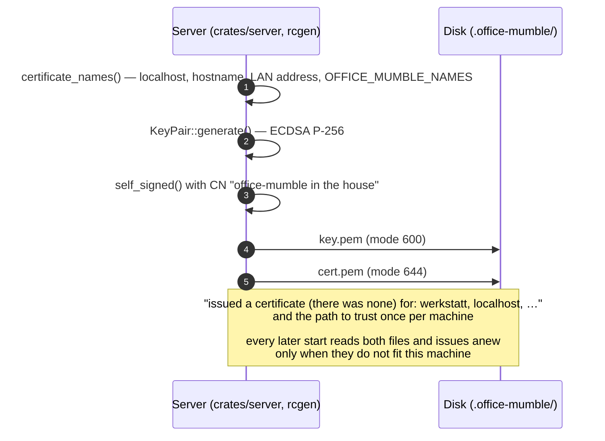
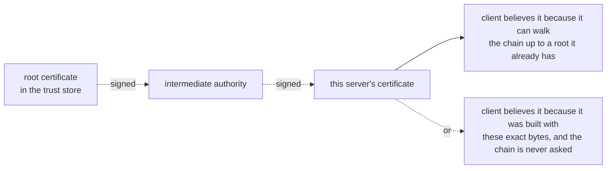
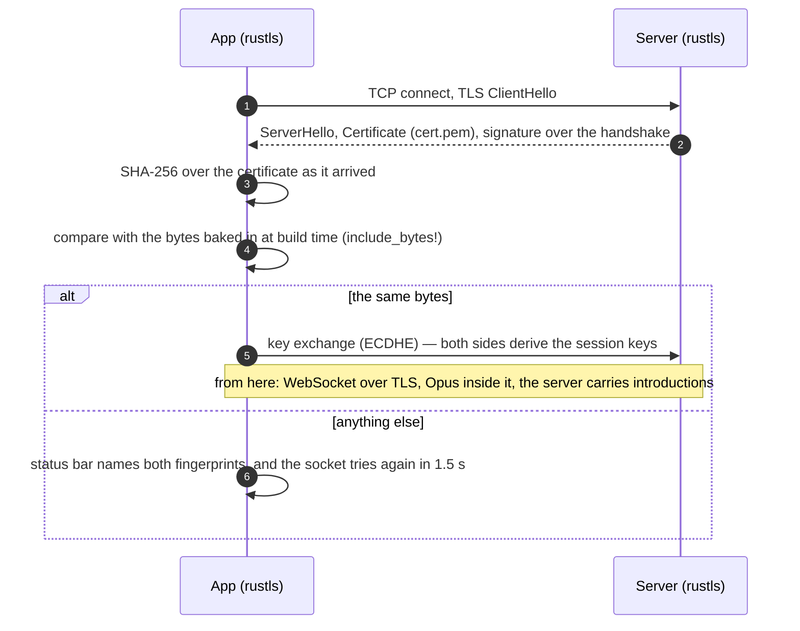

# TLS here: the certificate, the key, and who checks what

Every connection in this office is encrypted, and it manages that without a certificate authority: two files on
the server, one of them secret, and a client that recognises the server by remembering it. This page is the
mechanism — what is in the certificate, where it comes from, what happens to it when an app is built and when a
connection is opened, and what the file formats are. Building and installing the app is `docs/setup.md`; this is
what the build is building *for*.

## The two halves

TLS needs a pair that belongs together.

**A key pair.** The private key is a secret — 32 bytes on an elliptic curve here. The public key is derived from
it, and the derivation does not run backwards: the private key cannot be recovered from the public one. With the
private key one can **sign** something, and anybody can check that signature with the public key. The same pair
also lets two sides **agree on a session key** without either of them sending that key over the wire, and
everything after that handshake is encrypted with it, symmetrically, because that is much faster.

**A certificate.** It answers one question: *whose public key is this?* It holds the public key, a name, and a
signature over both, made with the private key of whoever issued it. Without a certificate, the key that arrives
could belong to anybody: the connection would still be encrypted, just not with the right person.

## What is in this office's certificate

`openssl x509 -in .office-mumble/cert.pem -noout -text` prints exactly what a TLS client reads:

| Field | Here | Means |
|---|---|---|
| Version, serial | 3, a random number | identification, and what a revocation list would name |
| Signature algorithm | `ecdsa-with-SHA256` | how the signature at the bottom is made |
| Issuer | `CN=office-mumble in the house` | who signed it |
| Subject | `CN=office-mumble in the house` | whose key it is — the same name, because it is **self-signed**: issuer and subject are one and the same |
| Validity | 1975-01-01 → 4096-01-01 | deliberately absurd: an appliance in a house should not stop because a date passed or a clock is wrong |
| Public key | ECDSA, curve P-256 | why the file is 595 bytes; with RSA it would be one to two kilobytes |
| Subject Alternative Name | `127.0.0.1`, `192.168.1.20`, `::1`, `werkstatt`, `werkstatt.local`, `localhost` | the names it *is* this server for |
| Signature | over all of the above | made with the private key; what a client checks |

The names are written when the certificate is issued: `localhost`, `127.0.0.1`, `::1`, the machine's
hostname and its `.local` form, the one LAN address the server can determine, and whatever `OFFICE_MUMBLE_NAMES`
adds (comma separated). The `.local` form is added because that is the name mDNS actually answers on a home
network, and a certificate that lacks it makes the name people are told the one that fails. The hostname is read where the platform keeps it — `/etc/hostname` on Linux, `COMPUTERNAME` on
Windows — so a server moved to another operating system still gets its own name into the list. A **browser**
accepts the server only under a name in that list, and shows a name mismatch for anything else. The **app**
accepts it only when the bytes are the ones it was built with, so a missing name costs the app nothing. A new
address — a different IP, or a name the machine did not have before — is therefore a **new certificate**: the
server sees on its next start that the certificate no longer names this machine, issues a new one over the old
pair and says so, and every app has to be built again.

## The two files

Both are PEM: plain text, the payload base64 between `-----BEGIN …-----` and `-----END …-----` lines, which is
binary ASN.1/DER made printable.

- **`cert.pem`** — the certificate alone, public. Readable by everybody (644), served at `/cert.pem`, imported
  into a browser's trust store, baked into the app.
- **`key.pem`** — the private key alone, in PKCS#8 (`BEGIN PRIVATE KEY`), 241 bytes, mode **600**. It never
  leaves the server: whoever holds it *is* this server. Losing it is not a loss of data — it is a new
  certificate and a rebuild of the apps.

Modes are a Unix idea. On Windows a file inherits its folder's permissions, which on a machine with more than one
account would leave the key readable by the others, so the inherited entries are cut when it is written and the
file is given to the account the server runs under and to `SYSTEM` (`icacls`, which ships with Windows). A
permission that could not be set is printed rather than passed over: a key on a disk is only as private as the
permissions over its file.

They are issued by the server itself on its first start and reused while they fit. On every start it checks
that both halves are there, that they load as a pair, and that the certificate names every name this machine has
right now; when one of those fails, it issues a new pair over the old one and prints the reason, together with
the warning that every app built against the old certificate refuses this server until it is built again. A
certificate that fits is never replaced, because it is what every app pins. For a new one on purpose,
`harness/recipes/steps/cert-renew` removes the pair and the next start issues one.



## Where a certificate comes from

Three ways, and the only real difference is **who the client believes**:

1. **A public authority** (Let's Encrypt, DigiCert, …). It checks that the applicant controls the name and signs
   the certificate. The client believes it because the authority's root certificate is already in its trust
   store, and the certificate arrives with the chain that leads there. Public authorities issue only for names
   that resolve on the internet — not for `192.168.1.20` — and Let's Encrypt's last 90 days.
2. **A company authority** (an AD domain, Intune). The same mechanism with a root of one's own, distributed by
   policy.
3. **Self-signed**, which is this office. There is no chain and no root, and nobody believes it automatically.
   So the trust is made by hand, in one of two ways: import the certificate once per machine, which is what a
   browser needs, or **pin** it, which is what the app does.



## At connection time



## What is deliberately not checked

- **No chain and no root.** There is nothing to walk: the certificate signs itself.
- **No hostname.** The address in a build may be an IP, `werkstatt`, or `werkstatt.local`; the names in the
  certificate matter to browsers only.
- **No expiry.** 1975 to 4096, so an appliance does not stop over a date.
- **No revocation.** Nothing to revoke against; a certificate that must not be used anymore is replaced with
  `cert-renew` and a restart.

What stands in for all of it is byte equality, and it is stricter than any of them: an attacker needs the exact
certificate, not merely one signed by somebody trusted. The price is that identity is decided at **build** time,
so a reissued certificate is a rebuild of every app — which is why the refusal names the two fingerprints it
compared instead of a category of error: that line is what says "this app was built for another certificate".

## At build time: baking the certificate in

```mermaid
sequenceDiagram
    autonumber
    participant B as harness/office.sh<br/>(office.cmd)
    participant S as Office server
    participant C as The clone
    participant W as cargo tauri build
    participant P as The built app

    B->>S: GET /cert.pem — the certificate cannot be trusted yet, it is being fetched
    S-->>B: the PEM
    B->>C: write it to .office-mumble/pinned.pem — every run, overwriting;<br/>never cert.pem, which is half of this machine's own pair
    C->>W: build
    W->>W: build.rs copies it to OUT_DIR/house-cert.pem
    W->>P: include_bytes! puts the bytes into the binary
    B->>P: read back — the fingerprint inside the app must equal the server's
    B->>P: and wss://<host> must be inside the app too
    Note over B,P: a mismatch or a missing address stops the run<br/>before anything is handed out
```

The script checks the **artifact**, never the inputs: a certificate that was right when the run began, a wrong
one named in `OFFICE_MUMBLE_CERT`, a build that never reached bundling, and an old `.app` left behind all end in
the same silent mismatch otherwise.

## The formats, and what `.pfx` is

The same bytes in different containers:

| Format | Holds | Usual on |
|---|---|---|
| **PEM** (`.pem`, `.crt`, `.key`) | text, base64; certificate and key usually separate files, may also be several blocks in one file | Linux, Rust, nginx, Apache, this office |
| **DER** (`.der`, `.cer`) | the same, binary, no base64 | embedded, some Windows tools |
| **PKCS#12** (`.pfx`, `.p12`) | **certificate and private key together**, encrypted with a password, may carry the chain | Windows: the file one double-clicks to import, IIS, .NET |
| **JKS** (`.jks`) | the same idea in Java's own format | Java app servers |

A `.pfx` is not another kind of certificate — it is a container. In C# that is `new X509Certificate2(path,
password)` (or `X509CertificateLoader.LoadPkcs12FromFile` in current .NET) to read it, and
`cert.Export(X509ContentType.Pfx, password)` to write one. From this office's two files:

    openssl pkcs12 -export -inkey key.pem -in cert.pem -out office-mumble.pfx

It is not used here because nothing on the Linux side needs a single password-protected file: the server reads
two PEMs, and the app does not read a certificate at all — it carries the bytes inside itself.

## Checking by hand

What the server presents, what the file says, and whether they are the same certificate:

    openssl x509 -in .office-mumble/cert.pem -noout -fingerprint -sha256
    openssl s_client -connect 192.168.1.20:8787 -showcerts </dev/null | openssl x509 -noout -fingerprint -sha256
    curl --cacert .office-mumble/cert.pem https://192.168.1.20:8787/health

What a built app carries — by **byte offset**, never by line: the binary is not text, and a line-based scan both
drags the bytes that stood on the same line into the PEM and, on macOS, dies on the first byte that is not valid
UTF-8 ("illegal byte sequence"):

    binary=<the app>/Contents/MacOS/office-mumble
    start=$(LC_ALL=C grep -abo -m1 -- "-----BEGIN CERTIFICATE-----" "$binary" | cut -d: -f1)
    end=$(LC_ALL=C grep -abo -m1 -- "-----END CERTIFICATE-----" "$binary" | cut -d: -f1)
    tail -c "+$((start + 1))" "$binary" | head -c "$((end - start + 25))" \
      | openssl x509 -noout -fingerprint -sha256

If that fingerprint equals the server's, the app is built for this house; if the address inside names another
machine, what is on disk is an older build and `client/src-tauri/target` wants deleting.
